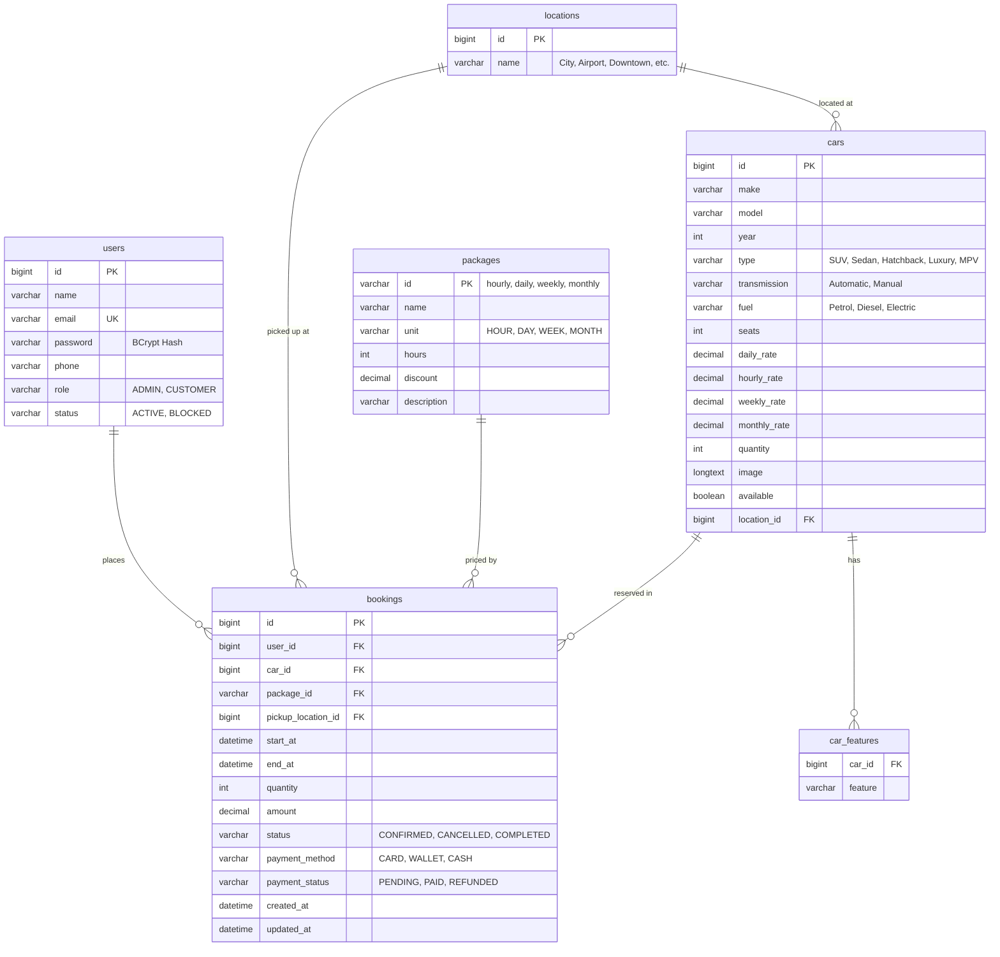

# 🗄️ Car Rental Database Setup (MySQL 8)

This directory contains the database schema and full dump for the Car Rental Management System.

---

## 📁 Files in this Directory

| File | Description |
|---|---|
| **`car_rental_dump.sql`** | Full MySQL dump containing all table structures, indexes, foreign keys, and initial seed data (cars, packages, locations, admin user). |
| **`schema.sql`** | Clean DDL-only SQL file containing only `CREATE TABLE` and constraint statements without sample data rows. |

---

## 🚀 How to Import into MySQL

### Option 1: Command Line (Windows / Linux / macOS)
1. Ensure your MySQL server is running (default port: `3306`).
2. Open terminal/PowerShell in this directory and execute:

```bash
# Create database if it does not exist
mysql -u root -p -e "CREATE DATABASE IF NOT EXISTS car_rental;"

# Import the full database dump (with seed data)
mysql -u root -p car_rental < car_rental_dump.sql
```
*(Enter your MySQL password when prompted — e.g. `1234`)*

---

### Option 2: MySQL Workbench
1. Open **MySQL Workbench** and connect to your local MySQL instance.
2. Go to **Server** ➜ **Data Import**.
3. Select **Import from Self-Contained File** and choose `car_rental_dump.sql`.
4. Set the Default Target Schema to `car_rental` (or create a new schema named `car_rental`).
5. Click **Start Import**.

---

## 📊 Database Schema Overview



---

## 🔑 Default Administrator Account

- **Email:** `admin@carrental.com`
- **Password:** `Admin@123` *(stored as BCrypt hash `$2a$10$...`)*
- **Role:** `ADMIN`
